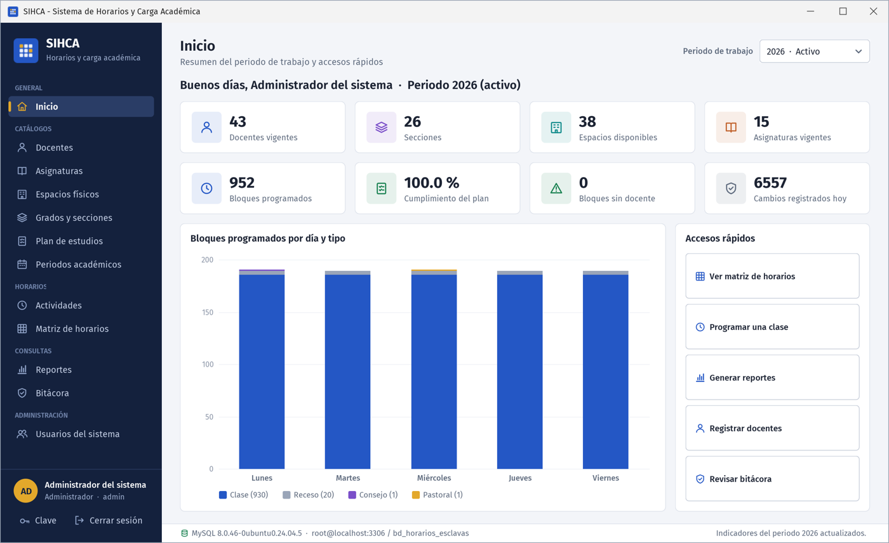
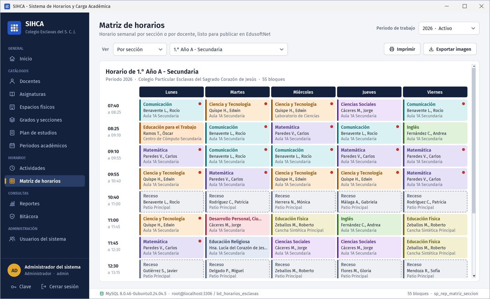
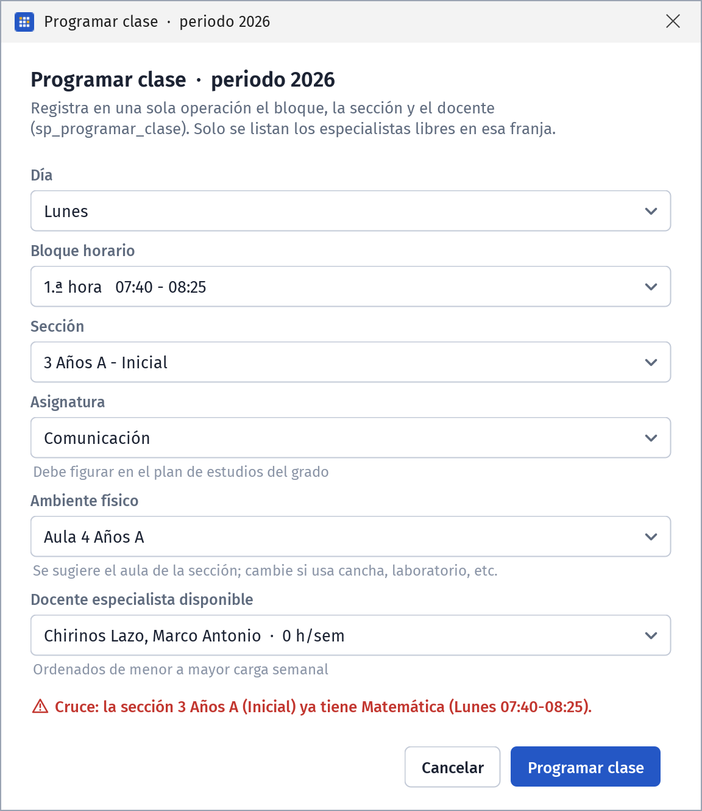

# SIHCA: Sistema de Horarios y Carga Académica

Aplicativo de escritorio de **uso general para instituciones educativas** (Inicial, Primaria y Secundaria) que permite
**asignar horarios y carga académica docente** sobre la base de datos MySQL **`bd_horarios_esclavas`**. Valida cruces de horario,
aforos de ambientes, especialidades y planes de estudio, y conserva el registro histórico de cada año lectivo.

Es el proyecto de laboratorio de **Gestión de Datos e Información (GDI), Grupo 09**, entregas 05 y 06.



## Características

- **Java SE (Swing) + JDBC nativo, sin frameworks ni ORM.** Toda la comunicación con MySQL se hace con
  `CallableStatement` (`{CALL sp_...(?, ?)}`).
- **Toda inserción, modificación y eliminación pasa por procedimientos almacenados** (75 procedimientos).
- **72 triggers**: 36 de reglas de negocio (BEFORE) y 36 de auditoría (AFTER) que alimentan la bitácora.
- **13 reportes** como procedimientos almacenados; **11 usan JOIN** entre varias tablas.
- **Borrado lógico** de docentes, asignaturas, espacios y usuarios que tienen historial. El **borrado físico**
  se permite solo cuando el registro no tiene historial.
- **Registro histórico**: un periodo cerrado queda en solo lectura, y su horario puede reutilizarse para un año nuevo.
- Matriz de horarios visual por sección o docente, exportable a PNG e imprimible.
- Exportación de reportes a Excel (CSV) e impresión o PDF.
- Inicio de sesión con 3 perfiles. Las contraseñas se guardan cifradas con SHA-256.
- **Instalador de la base de datos integrado**: crea toda la BD con datos de prueba en segundos.

Reglas de negocio que validan los triggers: periodo cerrado de solo lectura, aforo de espacios compartidos, cruces
de horario de docentes y secciones, especialidad del docente, horas del plan de estudios, tope semanal por nivel
(45/40/30 h), bloqueo del Consejo Directivo (lunes) y de la Pastoral, coherencia entre el tipo de bloque y el rol,
y jornada de 07:00 a 17:00.

| Matriz de horarios | Validación por trigger |
|---|---|
|  |  |

## Ejecución rápida (sin instalar nada)

1. Tener **MySQL Server 8.0** en ejecución.
2. Descargar la versión portable (carpeta `04_Ejecutable/SIHCA` de la entrega) y hacer doble clic en **`SIHCA.exe`**,
   o en `Iniciar_SIHCA.bat`. Incluye Java 17, así que no hace falta instalar Java.
3. En **Configurar conexión**, escribir la contraseña de `root` de MySQL y presionar **Instalar base de datos**.
4. Ingresar con una cuenta de prueba:

| Usuario | Contraseña | Perfil |
|---|---|---|
| `admin` | `admin123` | Administrador: todo, incluida la gestión de usuarios |
| `coordinador` | `coord123` | Coordinador: registra y modifica |
| `consulta` | `consulta123` | Consulta: solo ve y genera reportes |

Para instalar la BD manualmente, abra `sql/script_completo_bd_horarios_esclavas.sql` en MySQL Workbench y ejecútelo.

### Si Windows bloquea SIHCA.exe

- **SmartScreen** ("Windows protegió su PC"): elija *Más información → Ejecutar de todas formas*.
- **Control inteligente de aplicaciones** (Smart App Control, Windows 11): bloquea los programas sin firma
  digital comercial, como `SIHCA.exe` y `Iniciar_SIHCA.bat`, y no ofrece "Ejecutar de todas formas". Opciones:
  1. **Sin desactivarlo:** en la carpeta `SIHCA`, escriba `cmd` en la barra de direcciones del Explorador y ejecute
     ```
     runtime\bin\javaw.exe -jar app\sihca.jar
     ```
     `javaw.exe` es el Java incluido y está firmado por Eclipse Adoptium.
  2. **Desactivarlo:** *Seguridad de Windows → Control de aplicaciones y navegador → Configuración del control
     inteligente de aplicaciones → Desactivado*. En Windows 11 actualizado (abril de 2026 o posterior) se puede
     volver a activar desde la misma pantalla; en versiones anteriores requería restablecer Windows.

## Compilar desde el código fuente

Requisitos: JDK 11 o superior (en el PATH). No se necesita Maven ni Gradle; el único `.jar` externo es el driver
JDBC, incluido en `lib/`.

```bash
./build.sh            # Linux / macOS
build.bat             # Windows
java -cp "build/sihca.jar:lib/*" sihca.Main      # en Windows use ; en lugar de :
```

## Arquitectura

```
┌────────────────────────── Aplicativo cliente (Java 11+, Swing) ──────────────────────────┐
│  Capa de presentación   sihca.ui, sihca.ui.modulos, sihca.ui.componentes                 │
│        │  (pantallas, formularios, tablas, matriz, reportes)                             │
│  Capa de acceso a datos sihca.dao  ── un DAO por entidad, cada método = 1 procedimiento  │
│        │                                                                                 │
│  Infraestructura        sihca.datos (Conexion, BD, Resultado, Errores, InstaladorBD)     │
└────────┼─────────────────────────────────────────────────────────────────────────────────┘
         │ JDBC (MySQL Connector/J 8.4) · CALL sp_...
┌────────▼──────────────────────── MySQL 8.0 · bd_horarios_esclavas ───────────────────────┐
│  Procedimientos (CRUD + 13 reportes) ─► Tablas (13) ◄─ Triggers BEFORE (reglas)           │
│                                                   └─ Triggers AFTER  (Bitacora)           │
└──────────────────────────────────────────────────────────────────────────────────────────┘
```

## Estructura del repositorio

```
src/sihca/            Código fuente Java (documentado con Javadoc)
  Main.java           Punto de entrada
  datos/              Conexión JDBC, ejecución de procedimientos, instalador de la BD
  dao/                Acceso a datos: un DAO por entidad
  ui/                 Login, configuración de conexión, ventana principal, tema visual
  ui/componentes/     Botones, tablas, formularios, mensajes, íconos vectoriales
  ui/modulos/         Inicio, Docentes, Asignaturas, Espacios, Grados y secciones, Plan de estudios,
                      Periodos, Actividades, Matriz, Reportes, Bitácora, Usuarios
sql/
  01_creacion_bd.sql               Tablas, restricciones e índices
  02_funciones_triggers.sql        Funciones, validaciones y 72 triggers
  03_procedimientos_crud.sql       Procedimientos de inserción, modificación, eliminación y listado
  04_procedimientos_reportes.sql   13 reportes
  05_datos_prueba.sql              Datos: horarios 2025 (cerrado) y 2026 (activo), 22 secciones
  script_completo_bd_horarios_esclavas.sql   Todo lo anterior en un solo archivo
lib/                  mysql-connector-j-8.4.0.jar (driver JDBC oficial)
recursos/             Fuente Fira Sans (licencia SIL OFL) y MANIFEST.MF
lanzador/             Código C del lanzador SIHCA.exe para Windows (MinGW-w64)
herramientas/         Generador de datos de prueba (Python + OR-Tools) y pruebas de interfaz
docs/                 Javadoc y capturas
build.sh / build.bat  Compilación sin herramientas externas
```

## Normas de desarrollo aplicadas

- ISO/IEC 25010: modelo de calidad del producto de software (usabilidad, fiabilidad, mantenibilidad, seguridad).
- ISO/IEC/IEEE 12207: procesos del ciclo de vida del software.
- ISO/IEC 9075 (SQL estándar), con las extensiones procedurales de MySQL.
- Convenciones de código Java (Oracle Code Conventions) y documentación con Javadoc.
- OWASP: consultas parametrizadas contra la inyección SQL y contraseñas con hash.

## Equipo (GDI · Grupo 09)

Carnero Moran, Victor Paolo · Lipa Lipa, Luis Ángel · Morote Espinoza, Renzo Franco ·
Motta Flores, Eduardo Mateo · Ventura Huamán, Joel Eloy

## Componentes de terceros

- [MySQL Connector/J 8.4.0](https://dev.mysql.com/downloads/connector/j/) (GPLv2 con excepción FOSS)
- [Eclipse Temurin JRE 17](https://adoptium.net/) (GPLv2 con Classpath Exception), solo en la versión portable
- [Fira Sans](https://github.com/mozilla/Fira) (SIL Open Font License 1.1)
